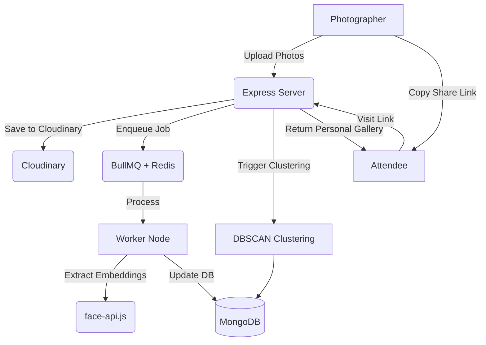

# EventSnap

EventSnap helps photographers turn a massive event photo dump into per-person, easily shareable galleries. It detects faces, automatically groups photos by person, and generates direct gallery links that photographers can share with attendees.

## What it includes

- Background processing with BullMQ and Redis
- Face clustering with `face-api.js` and DBSCAN
- Photographer dashboard with auto-generated "Person Folders"
- Direct, shareable attendee gallery links (no registration or selfies required)
- Cloudinary image storage

## Architecture



## Setup Instructions

### Prerequisites
- Node.js (v18+)
- MongoDB (local or Atlas)
- Redis (local or remote)
- Cloudinary Account

### Environment variables

Copy `.env.example` to `.env` for the API and worker. Copy `client/.env.example` to `client/.env` for the web app.

API / worker:
```
MONGO_URI=mongodb://localhost:27017/ai-event-photos
REDIS_URL=redis://localhost:6379
CLOUDINARY_CLOUD_NAME=your_cloud_name
CLOUDINARY_API_KEY=your_api_key
CLOUDINARY_API_SECRET=your_api_secret
PORT=5000
CLIENT_URL=http://localhost:5173
```

Client:

```
VITE_API_URL=http://localhost:5000
```

### Installation
1. Install root dependencies:
   ```bash
   npm install
   ```
2. Install server dependencies and download face-api models:
   ```bash
   cd server
   npm install
   npm run weights
   ```
   `server/.npmrc` sets `legacy-peer-deps`, because `multer-storage-cloudinary` still declares a peer dependency on Cloudinary v1. Without it `npm install` stops with an `ERESOLVE` error.
3. Install client dependencies:
   ```bash
   cd ../client
   npm install
   ```

### Running the App
Run the entire stack (client, server, and worker) simultaneously from the root:
```bash
npm run dev
```

## Deployment

The client and API are deliberately deployed separately: GitHub Pages can host the static client, but the API and face-processing worker require a Node host, MongoDB, Redis, and persistent configuration.

1. Push this repository to GitHub.
2. Create MongoDB, Redis, and Cloudinary services.
3. On Render, create a Blueprint from this repository. It reads `render.yaml` and provisions the API plus a separate worker. Add the required secret environment variables in Render.
4. Deploy `client` to Vercel, Netlify, or GitHub Pages. Set `VITE_API_URL` to the public API URL before the build, and set the API's `CLIENT_URL` to the final client URL. For more than one allowed frontend URL, provide a comma-separated `CLIENT_URL` value.

Before making the repository public, verify that `.env` is not tracked and rotate any credentials that have been exposed.

## Technical notes

### DBSCAN vs K-Means
DBSCAN was chosen over k-means because event photo groupings are highly variable. We don't know the value of `k` (the number of unique attendees) beforehand. DBSCAN natively groups by density and separates outliers, meaning we don't need to specify the number of clusters. 

### Async Job Queue
Processing 100+ high-resolution photos for face detection is CPU-intensive. Doing this synchronously in the Express request handler would cause timeouts and block the event loop for other users. BullMQ + Redis provides robust retries, failure handling, and offloads heavy computation to a separate worker process.

## Tests

The clustering logic (`server/clustering.js`) and the upload file filter have unit tests:

```bash
cd server
npm test        # 11 tests, Node's built-in test runner
```

They run in GitHub Actions on every push, alongside the client lint and build. There are no API or end-to-end tests yet; those need MongoDB and Redis.

## Privacy and security

EventSnap processes faces, which are biometric data. This is a portfolio project and is **not ready for real events** as it stands. What the code does today, and what is missing:

| Area | Current state |
| --- | --- |
| Face embeddings | Stored in MongoDB as plain 128-number arrays next to each photo. They are not encrypted and are **not anonymous**: an embedding can be matched against other photos of the same person, and research has shown faces can be approximately reconstructed from embeddings. Treat them like the photos themselves. |
| Consent | Not collected. A real deployment needs the organiser's and attendees' consent before any face processing. |
| Access control | None. There are no accounts. Anyone who has an event ID or a gallery link can read it. |
| Share links | A gallery link contains the cluster's MongoDB ID. That ID is hard to guess by accident but is not a secret token, and links never expire. |
| Retention and deletion | Nothing is deleted automatically, and there is no endpoint to delete an event, a photo or a person's gallery. Re-running clustering replaces the old clusters only. |
| Uploads | JPEG and PNG only, 15 MB per file, 50 files per request. The upload and clustering routes are limited to 30 requests per 15 minutes per IP. Photos are stored on Cloudinary under your account. |
| Transport and origin | CORS is restricted to `CLIENT_URL`. HTTPS depends on the host. |

Before using this with real people it would need, at minimum: consent capture, organiser authentication, random expiring share tokens, a delete endpoint with a retention window, and encryption at rest for embeddings.

## What I'd add with more time
- Random, expiring share tokens and a delete endpoint (see Privacy and security).
- Automated email delivery of share links.
- A custom-trained or heavier face embedding model (like ArcFace or AdaFace) for better accuracy in challenging lighting.
- High-performance vector database (e.g., Qdrant or Milvus) to scale matching when clustering thousands of events.
